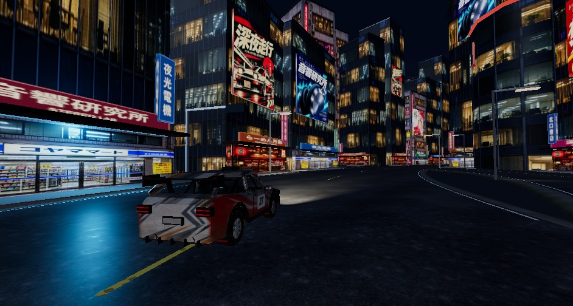

# Tokyo After Hours · 東京・深夜

Select **Tokyo After Hours** in the map chooser. **City Explorer** starts in Shibuya. Follow the Shibuya circuit to the signed parking entrance and enter at 1F. Turn onto the oval to climb to 7F or descend to B2. **Night guide** holds activities, camera angles, JPEG export, weather, parking density and four original radio stations.

## Road network

The city uses metre-scale Three.js geometry. These distances were measured from the shipped centreline samples, including changes in elevation.

| Route | Distance | Connection |
| --- | ---: | --- |
| Shibuya Neon Circuit | 2,998 m | Shares Shibuya Crossing with the main loop and branches to the parkade |
| Tokyo Midnight Circuit | 4,998 m | Connects Shibuya, Minato, Electric Town and the auto meet |
| Metropolitan Expressway | 9,000 m | Branches from the main loop, climbs to 19 m and descends into the tunnel |
| Tokyo Bay Run | 3,999 m | Connects the main loop to the docks and gymkhana apron |
| Grand Tokyo Tour | 14,992 m | Pins the long circuit to junctions in the other districts |
| Midnight Parkade | 2,263 m | One continuous two-way oval with a street entrance at 1F |
| Underground Echo | 2,190 m | Timed sector of the expressway |

Four service streets link the circuits. Road queries include vehicle height so two decks can overlap in plan without exchanging wheel contacts, checkpoint progress or recovery positions. Barriers have openings where roads meet at the same height. The garage uses a 110 × 58 m centreline oval. Each turn includes a level landing and a smooth 5.6 m rise. B2 starts 11.2 m below street level and the 7F rooftop is 33.6 m above it. A seeded parking layout is used during competition. Free roam draws a fresh layout from marked bays at the chosen density.

## Activities

The race menu includes Neon Crown, Downtown sprint and endurance, the expressway, the bay circuit, Underground Echo, Grand Tokyo Tour and the full garage ascent and descent. The Night Guide adds eight-district exploration, four-district photography, three Tower viewpoints, three workshop discoveries, the eight-deck championship, a timed B2 drift challenge, a rooftop drift unlock, dockside gymkhana, a rival race and two tandem challenges. Completing the tower photography journal unlocks Minato Gold in the garage. Discovery, completion, reward and preference data use the game's career store and a local Tokyo passport.

## Art, signage and audio manifest

| Assets | Source and use |
| --- | --- |
| `src/assets/maps/tokyo-{office,shops,ramen,market}.webp` | Four original ImageGen facade tiles, 512 × 512 each. Applied to street-level retail and office meshes. |
| `src/assets/maps/tokyo-ad0.webp` through `tokyo-ad3.webp` | Four original ImageGen billboard panels, 512 × 512 each. Billboards rotate through the four designs. |
| `src/assets/maps/tokyo-skyline.webp` | Original generated panoramic skyline, 2,172 × 724. Used for the distant city and car reflections. |
| `src/assets/maps/tokyo-tower.glb` | Original Blender mesh with three materials, 2,232 vertices and 1,472 source polygons. Rebuild with `make_tower(destination)` in `tools/blender/tokyo/tower.py`. The model is scaled to the Minato sightline. |
| `tokyoKit.js`, `TokyoCity.js`, `TokyoLife.js`, `tokyoRoads.js` | Original procedural street furniture, parked coupes and hatchbacks, parking decks, taxis, train, dock props, lighting, signage and road meshes. |
| `TokyoSound.js` | Original synthesized radio phrases and environmental cues. Garage and tunnel returns use the game's existing engine and tyre audio. |
| `src/assets/maps/previews/tokyo.jpg` and the gallery below | Captures from the actual WebGL scene. |

Navigational and primary storefront lettering is drawn from Unicode strings using system Japanese font fallbacks. Examples include 喫茶つばき (Tsubaki Coffee), 北口書店 (North Exit Books), 入口 (entrance), 出口 (exit) and 屋上展望台 (rooftop observation deck). Bilingual signs supplement vertical shop blades. Small print baked into decorative generated textures has not been copy-edited in Japanese.

The new art and audio were authored for this project. The reference photographs, movie material, commercial game audio and extracted game models are excluded from the assets. The game's existing cars, fonts and dependencies retain their existing licensing terms.

## In-engine location gallery

| Street districts and landmarks | Garage levels |
| --- | --- |
| [Shibuya Crossing](shibuya.jpg) · [Minato and Tokyo Tower](minato.jpg) | [B2](b2.jpg) · [B1](b1.jpg) |
| [Akihabara Electric Town](akihabara.jpg) · [Shinjuku Backstreets](shinjuku.jpg) | [1F](1f.jpg) · [2F](2f.jpg) |
| [Expressway](expressway.jpg) · [Tunnel](tunnel.jpg) | [3F](3f.jpg) · [4F](4f.jpg) |
| [Tokyo Bay](bay.jpg) · [Midnight Auto Meet](meet.jpg) | [5F](5f.jpg) · [6F](6f.jpg) · [7F rooftop](roof.jpg) |

## Implementation and verification

- [x] Based on owner main `fe27e49`. Map selection, roads, layered wheel contact, camera, checkpoint timing and minimap integrate with the shared game. Tokyo-specific scenery, missions and audio live in separate modules.
- [x] All eight distinct courses completed with the scripted driver and zero respawns. The ascent and descent each cleared 30 checkpoints. The garage tests sample ground and progress every 2 m and settle the vehicle on all nine levels.
- [x] Sampled all roads for obstacles at 4 m intervals on the centreline and two parallel lines 2 m to either side. Verified both traffic modes, the three phases of passing showers, seven photo captures, the reward conditions and persistence of all 11 Night Guide activities. Mission checks use controlled location and drift inputs. Course completion uses the vehicle simulation.
- [x] Production Vite build and full repository test command pass. To reproduce the browser run, set `TOKYO_ACTIVITIES=1` and `TOKYO_DRIVE=1`, then run `node artifacts/tokyo/verify.cjs` from the project. The verifier uses Chrome and accepts a `CHROME_PATH` override.
- [x] Tested the garage start on Intel UHD Graphics through Chrome/ANGLE D3D11, Low quality, at 942 × 504. Two 90-frame samples after optimization measured 16.4–16.8 ms median and 21.3–21.9 ms at the 95th percentile, with 274 draw calls and 326,306 triangles. These measurements cover one camera position. District geometry batches, nearby-deck visibility and three reused point lights bound the active scene.
- [ ] Visual and device follow-up. Building modules repeat along long stretches, the far skyline is a panorama, exhibition crowds are static, and service taxis follow fixed routes. Reflected sign light is approximated. The existing racing ghosts and still-photo tools are available. A cut-edited cinematic replay director, extended memory soak, mobile GPU benchmark and live multiplayer validation remain outstanding. The shared production bundles trigger Vite's 500 kB advisory. Intel's shader compiler also emits precision warnings.

Shibuya's sign hierarchy, the expressway's long sightlines and the transition from street races to a quieter car meet informed the layout. The city uses fictional shops and route geography. [GO TOKYO · Shibuya Center-Gai](https://www.gotokyo.org/en/spot/88/index.html) · [Metropolitan Expressway driving guide](https://www.shutoko.jp/ss/shutokodeikou/special/driving_tokyo/en.html) · [Need for Speed Heat manual](https://www.ea.com/able/resources/need-for-speed/need-for-speed-heat/pc/text-manual) · [Genki · Tokyo Xtreme Racer](https://store.steampowered.com/app/2634950/Tokyo_Xtreme_Racer/)
